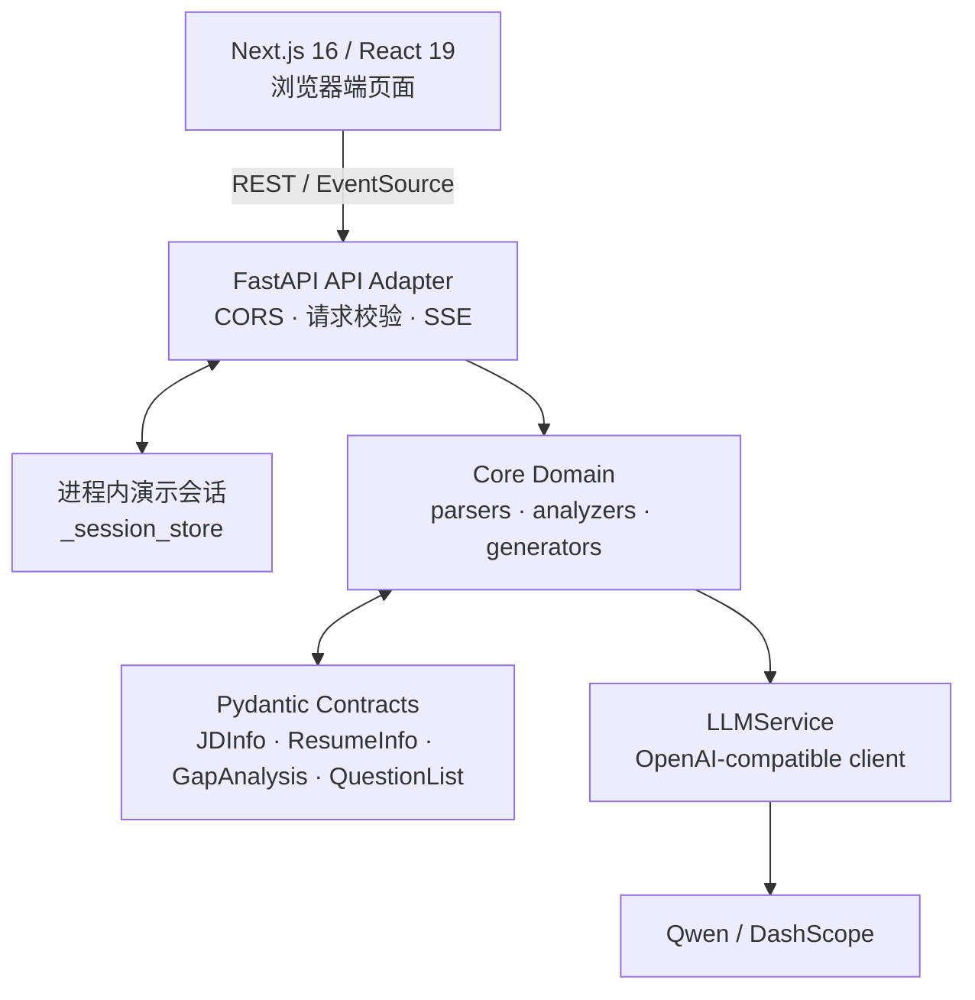
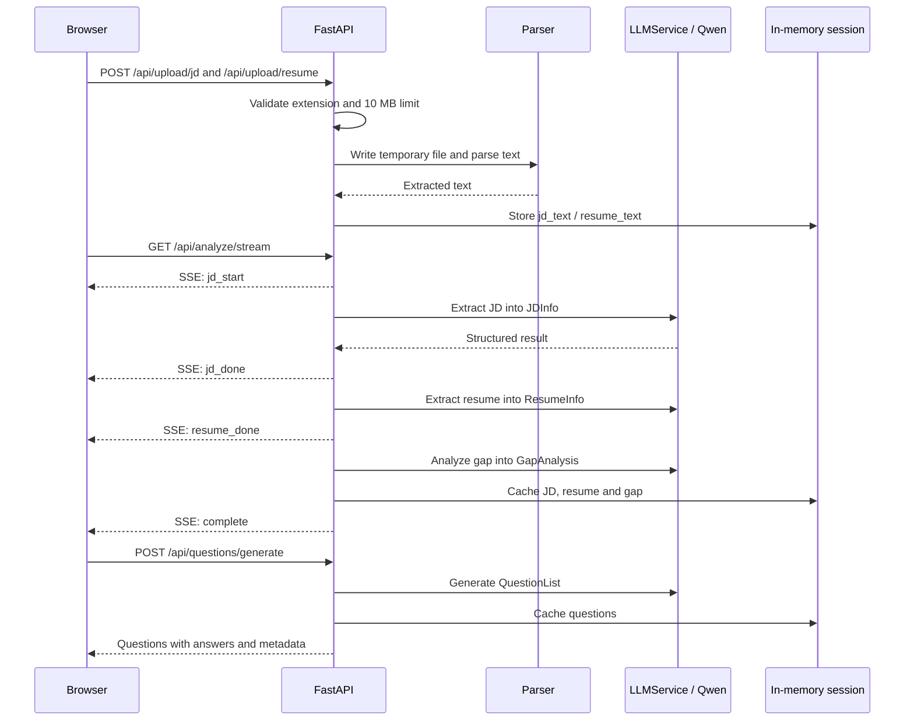

# Architecture

> **Interview Prep Assistant** 的当前实现说明。本文以 `codex/qwen-provider-migration` 分支中的代码为准，而非历史规划。

## 1. 架构目标

系统将非结构化的 JD 与简历转换为可消费的面试准备材料。设计重点是：用强类型数据契约收敛大模型输出、让长耗时分析可观察，并将 UI、HTTP 适配、业务流程、模型调用和文档解析解耦。



## 2. 组件职责

| 层级 | 目录 / 组件 | 职责 |
| --- | --- | --- |
| 体验层 | `frontend/app`、`frontend/components` | 首页上传、分析报告、题库与求职画像界面。 |
| 前端适配层 | `frontend/lib/api.ts` | 统一 REST / SSE 客户端、类型映射与 API 地址配置。 |
| API 层 | `api/main.py`、`api/routes` | 注册路由、CORS、输入校验、HTTP 错误映射与流式响应。 |
| 会话层 | `api/main.py::_session_store` | 暂存文本、结构化分析与题目；仅用于单进程演示。 |
| 领域层 | `core/parsers`、`core/analyzers`、`core/generators` | 解析文件、抽取信息、完成差距分析、生成并去重题目。 |
| 契约层 | `models/schemas.py`、`api/schemas.py` | 定义 LLM 结构化输出与 HTTP 请求/响应模型。 |
| 基础设施层 | `services/llm_service.py`、`utils`、`config.py` | Qwen 客户端、重试、日志、token/cost 记录与环境配置。 |

## 3. 核心请求链路



### 上传与解析

`/api/upload/jd` 与 `/api/upload/resume` 只接受 PDF、DOCX、TXT，限制为 10 MB。上传内容写入临时文件后由 `parser_factory` 分发至对应解析器；无论成功还是失败，临时文件都会在 `finally` 中删除。重新上传会失效相关下游缓存，避免 JD、简历与题库交叉污染。

### 流式分析

`/api/analyze/stream` 按 **JD 抽取 → 简历抽取 → 差距分析** 顺序执行。领域分析器是同步调用，因此路由使用 `asyncio.to_thread` 避免阻塞 FastAPI 事件循环，并在每一阶段通过 SSE 发送事件。前端 `EventSource` 在 `complete` 或 `error` 后关闭连接。

### 题目生成

题目生成的输入是 `GapAnalysis`、`ResumeInfo` 与 `JDInfo`。10 题以内使用单批生成；更大题量按每批最多 8 题生成。每批会过滤空参考答案，并用精确匹配与 `SequenceMatcher` 相似度（大于 0.85）排重；题量不足时尝试补齐。

## 4. 数据契约与模型边界

`models/schemas.py` 是核心领域模型的唯一来源：

- `JDInfo`：岗位、必备/加分技能、职责、经验、教育与职级。
- `ResumeInfo`：技能、工作经历、项目、教育、证书、语言与年限。
- `GapAnalysis`：四个评分维度、匹配/缺失技能、优势、短板与建议；总分限制在 0–100。
- `Question` / `QuestionList`：题干、题型、难度、考察点、意图与参考回答。

LLM 服务通过 OpenAI SDK 的 `chat.completions.parse` 解析到这些 Pydantic 模型，而不是让 API 层依赖未经校验的 JSON。HTTP 输入/输出模型则位于 `api/schemas.py`，避免传输模型反向污染领域模型。

## 5. LLM 集成与可靠性

- 提供商通过 `.env` 配置为 DashScope 的 OpenAI-compatible endpoint；当前默认模型为 `qwen3.7-plus`。
- 结构化调用不传输出 token 上限，避免 JSON 因截断而无法解析；保留温度配置和 `enable_thinking` 开关。
- SDK 配置网络重试；结构化结果解析失败还会进行一次应用层重试。
- 服务记录输入/输出 token、耗时及可选的按百万 token 成本估算，不记录 API 密钥。

## 6. 前端实现

前端的主要路由为：

| 路由 | 作用 | 后端依赖 |
| --- | --- | --- |
| `/` | 上传 JD 与简历并展示文件反馈 | `POST /api/upload/*` |
| `/analyze` | 展示 SSE 进度及匹配结果 | `GET /api/analyze/stream`、`GET /api/analyze/result` |
| `/questions` | 生成、筛选、搜索与收藏题目 | `POST /api/questions/generate`、`GET /api/questions/cached` |
| `/profile` | 求职画像页面 | `POST /api/profile/generate`（当前为后端占位数据） |

前端默认连接 `http://localhost:8000`，可通过 `NEXT_PUBLIC_API_URL` 覆盖。题库页在 API 失败时展示内置示例题以保证页面可演示；这是 UI 降级策略，不是服务端缓存。

## 7. 当前仓库结构

```text
interview-prep-assistant/
├── api/                  # FastAPI 应用、路由和 HTTP 模型
├── core/
│   ├── analyzers/        # JD、简历和差距分析
│   ├── generators/       # 面试题生成、补足与去重
│   └── parsers/          # PDF / DOCX / TXT 解析器
├── frontend/             # Next.js Web 应用
├── models/               # Pydantic 领域模型
├── prompts/              # 结构化抽取与题目生成提示词
├── services/             # LLM 网关
├── tests/                # 单元、集成与 API 冒烟测试
├── utils/                # 日志、token 估算、文本与校验工具
├── config.py             # 环境与全局配置
├── README.md             # 项目介绍与本地运行
└── Architecture.md       # 当前架构说明
```

`app/` 与 `run_app.py` 保留了早期 Streamlit 原型代码；它们不是当前 Web 产品的启动入口，也不参与 Next.js + FastAPI 主链路。

## 8. 测试与可观测性

`tests/` 覆盖解析器、分析器、题目生成器、LLM 服务和 API 冒烟场景。运行 `pytest` 执行后端测试；在 `frontend/` 运行 `npm run lint` 执行前端静态检查。应用日志由 `utils/logger.py` 统一配置，LLM 调用会记录模型、耗时、token 与可选成本。

## 9. 已知限制与演进边界

以下限制是当前实现的真实边界，不是已交付能力：

- 会话数据位于单个 Python 进程的全局字典中，不具备多用户隔离、持久化、重启恢复或多实例扩展能力。
- CORS 仅允许本地 `localhost:3000` / `127.0.0.1:3000` 开发来源。
- 无认证、授权、对象存储、速率限制或敏感信息脱敏流程。
- 求职画像路由返回占位数据；模拟面试、历史记录和报告导出尚未实现。

面向生产环境时，优先将会话移至具 TTL 的 Redis 或数据库并引入用户边界；随后补充文件扫描/对象存储、认证授权、限流、审计与可观测性指标。
