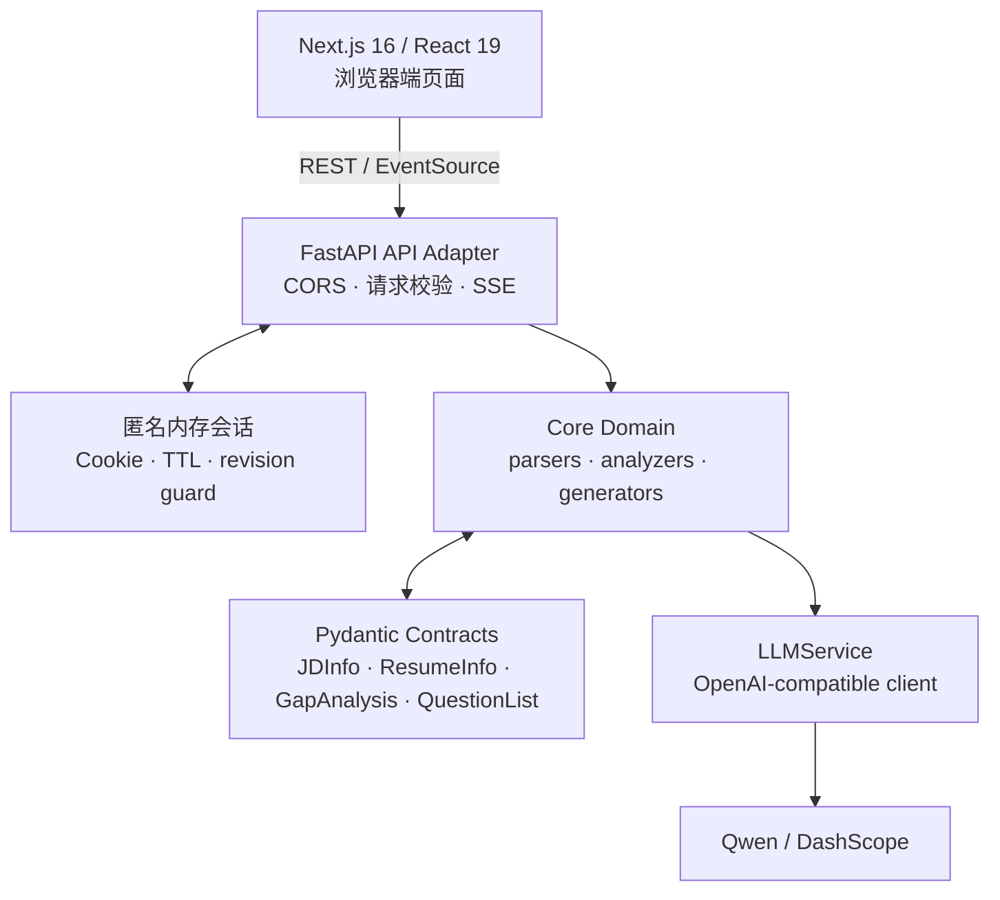
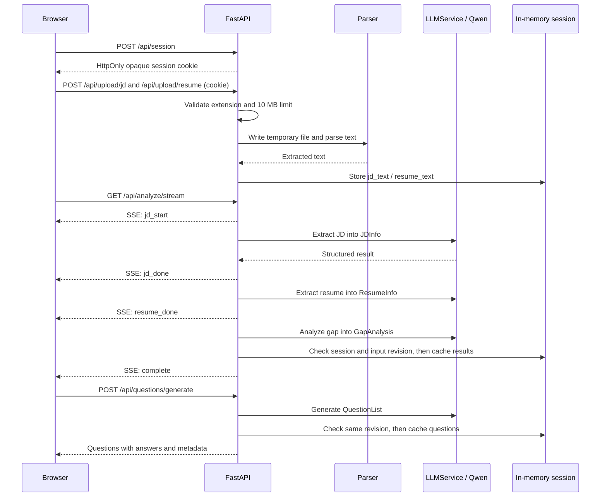

# Architecture

> **Interview Prep Assistant** 的当前实现说明。本文以 `codex/qwen-provider-migration` 分支中的代码为准，而非历史规划。

## 1. 架构目标

系统将非结构化的 JD 与简历转换为可消费的面试准备材料。设计重点是：用强类型数据契约收敛大模型输出、让长耗时分析可观察，并将 UI、HTTP 适配、业务流程、模型调用和文档解析解耦。



## 2. 组件职责

| 层级 | 目录 / 组件 | 职责 |
| --- | --- | --- |
| 体验层 | `frontend/app`、`frontend/components` | 首页上传、分析报告、题库与求职画像界面。 |
| 前端适配层 | `frontend/lib/api.ts` | 统一 REST / SSE 客户端、类型映射与 API 地址配置。 |
| API 层 | `api/main.py`、`api/routes` | 注册路由、CORS、输入校验、HTTP 错误映射与流式响应。 |
| 会话层 | `api/session.py::SessionStore / Session / Operation` | 隔离访客、限制容量和闲置生命周期；输入快照及版本校验阻止晚到写回，仍为单进程内存。 |
| 领域层 | `core/parsers`、`core/analyzers`、`core/generators` | 解析文件、抽取信息、完成差距分析、生成并去重题目。 |
| 契约层 | `models/schemas.py`、`api/schemas.py` | 定义 LLM 结构化输出与 HTTP 请求/响应模型。 |
| 基础设施层 | `services/llm_service.py`、`utils`、`config.py` | Qwen 客户端、重试、日志、token/cost 记录与环境配置。 |

## 3. 核心请求链路



### 上传与解析

`/api/upload/jd` 与 `/api/upload/resume` 只接受 PDF、DOCX、TXT，限制为 10 MB。上传内容写入临时文件后由 `parser_factory` 分发至对应解析器；无论成功还是失败，临时文件都会在 `finally` 中删除。重新上传会失效相关下游缓存，避免 JD、简历与题库交叉污染。

### 流式分析

`/api/analyze/stream` 按 **JD 抽取 → 简历抽取 → 差距分析** 顺序执行。领域分析器是同步调用，因此路由使用 `asyncio.to_thread` 避免阻塞 FastAPI 事件循环，并在每一阶段通过 SSE 发送事件。前端 `EventSource` 在 `complete` 或 `error` 后关闭连接。

各路由通过请求依赖获得同一个匿名会话。`Session.begin`捕获输入与revision，重传/清除/重分析会使旧revision失效；`Operation.run/publish`在线程返回后校验存活与版本，防止旧报告/题目恢复。分析使用本次局部JD/简历结果，不从可能已变更的共享字段拼装输入。同类任务冲突明确提示，不排队。连接取消后同步线程可能继续运行，忙槽保留到实际线程结束；不承诺中止供应商调用。上传的分文件序号还阻止较早上传覆盖清除或较新输入。

Cookie只含随机ID，HttpOnly、SameSite=Lax；HTTPS时可启用Secure。默认闲置1800秒/100会话，`SESSION_TTL_SECONDS`/`SESSION_MAX_COUNT`可配置；有效会话满额返回503，不驱逐活跃数据。过期在后续访问/创建时清理，返回410并删除Cookie，显式后续操作可建立空会话。重启丢失全部资料；健康检查不创建会话/暴露数据键，API响应no-store。重要取舍见[ADR0004](docs/development/decisions/0004-anonymous-memory-sessions.md)。

### 题目生成

题目生成的输入是 `GapAnalysis`、`ResumeInfo` 与 `JDInfo`。10 题以内使用单批生成；更大题量按每批最多 8 题生成。每批会过滤空参考答案，并用精确匹配与 `SequenceMatcher` 相似度（大于 0.85）排重；题量不足时尝试补齐。

## 4. 数据契约与模型边界

`models/schemas.py` 是核心领域模型的唯一来源：

- `JDInfo`：岗位、必备/加分技能、职责、经验、教育与职级。
- `ResumeInfo`：技能、工作经历、项目、教育、证书、语言与年限。
- `GapAnalysis`：四个评分维度、匹配/缺失技能、优势、短板与建议；总分限制在 0–100。
- `Question` / `QuestionList`：题干、题型、难度、考察点、意图与参考回答。

LLM 服务通过 OpenAI SDK 的 `chat.completions.parse` 解析到这些 Pydantic 模型，而不是让 API 层依赖未经校验的 JSON。HTTP 输入/输出模型则位于 `api/schemas.py`，避免传输模型反向污染领域模型。

## 5. LLM 集成与可靠性

- 提供商通过 `.env` 配置为 DashScope 的 OpenAI-compatible endpoint；当前默认模型为 `qwen3.7-plus`。
- 结构化调用不传输出 token 上限，避免 JSON 因截断而无法解析；保留温度配置和 `enable_thinking` 开关。
- SDK 配置网络重试；结构化结果解析失败还会进行一次应用层重试。
- 服务记录输入/输出 token、耗时及可选的按百万 token 成本估算，不记录 API 密钥。

## 6. 前端实现

前端的主要路由为：

| 路由 | 作用 | 后端依赖 |
| --- | --- | --- |
| `/` | 上传 JD 与简历并展示文件反馈 | `POST /api/upload/*` |
| `/analyze` | 展示 SSE 进度及匹配结果 | `GET /api/analyze/stream`、`GET /api/analyze/result` |
| `/questions` | 生成、筛选、搜索与收藏题目 | `POST /api/questions/generate`、`GET /api/questions/cached` |
| `/profile` | 画像尚未开放说明，提供分析/题库入口 | 不调用画像 API；`POST /api/profile/generate` 仍为未接入页面的历史占位接口 |

前端默认连接`http://localhost:8000`，可通过`NEXT_PUBLIC_API_URL`覆盖。REST通过共享初始化Promise建立Cookie，再以credentials发送；EventSource使用withCredentials。首页刷新读取上传状态，分析页先恢复当前会话报告，仅404才启动新分析；缓存错误/410不会自动重放分析。APIError保留HTTP status；题库进入/刷新仅GET缓存，404展示显式生成入口，只有按钮才能POST生成；409保留等待状态并提供只读检查，错误不自动展示示例。示例通过独立按钮主动预览。请求锁阻止同页重复提交，请求序号屏蔽卸载后的晚到响应。区分本会话缓存、本次生成与固定非个性化示例，显式重试可再次请求；换题集清空收藏。过期/无资料时引导返回首页重新上传。

## 7. 当前仓库结构

```text
interview-prep-assistant/
├── api/                  # FastAPI 应用、路由和 HTTP 模型
├── core/
│   ├── analyzers/        # JD、简历和差距分析
│   ├── generators/       # 面试题生成、补足与去重
│   └── parsers/          # PDF / DOCX / TXT 解析器
├── frontend/             # Next.js Web 应用
├── models/               # Pydantic 领域模型
├── prompts/              # 结构化抽取与题目生成提示词
├── services/             # LLM 网关
├── tests/                # 单元、集成与 API 冒烟测试
├── utils/                # 日志、token 估算、文本与校验工具
├── config.py             # 环境与全局配置
├── README.md             # 项目介绍与本地运行
└── Architecture.md       # 当前架构说明
```

`app/` 与 `run_app.py` 保留了早期 Streamlit 原型代码；它们不是当前 Web 产品的启动入口，也不参与 Next.js + FastAPI 主链路。

## 8. 测试与可观测性

`tests/`包含外部模型测试，日常只用已审阅的`python scripts/check_backend.py`；前端用`npm run check`。会话测试以可控时钟、线程阻塞点和合成资料验证隔离/交错；生产浏览器使用合成模型服务，详见[质量门禁](docs/development/quality-gates.md)。应用日志由`utils/logger.py`配置，LLM调用记录模型、耗时、token与可选成本。

## 9. 已知限制与演进边界

以下限制是当前实现的真实边界，不是已交付能力：

- 会话已按匿名Cookie隔离，数据仍只在一个Python进程内；没有持久化、重启恢复、多实例/多worker共享或账号跨设备能力。
- CORS 仅允许本地 `localhost:3000` / `127.0.0.1:3000` 开发来源。
- 可选GitHub账号登录、PostgreSQL记录管理与账号记录业务API已实现（默认关闭），记录所有权取自账号Cookie，写入检查Origin。`/api/records/{id}/upload/{kind}`保存解析文本并递增revision；POST分析SSE与题目生成领取持久attempt、复用现有领域分析器，完整快照和完成状态一起提交。写回前在短暂账号锁内重验原Cookie，退出/过期后的结果不发布。重传/删除/新attempt拒绝旧写回；断连的同步线程结束前保留占用，其后只中断原attempt。启用账号时单worker启动先中断遗留任务，不自动生成/迁移。详见[登录](docs/development/github-auth.md)与[存储/API](docs/development/history-storage.md)手册。新增`/history`独立账号工作区，客户端`history-api.ts`不初始化匿名会话；记录选择保存在URL查询参数，仅标识记录、不承载身份。刷新只GET，分析用fetch读取POST SSE，题库明确按钮生成，无自动重连/重试。切换按account+record重新挂载，取消流并屏蔽旧响应；401清空账号视图、409丢弃旧展示待明确刷新，已有结果与任务状态分开展示。20份上限/改名/二次确认删除可用。双设备浏览器拦截合成API验收通过，浏览器直连完整后端/真实OAuth仍待验收；原首页继续匿名链路。
- 无对象存储、速率限制或完整敏感信息脱敏流程。求职画像路由返回占位数据；模拟面试和报告导出尚未实现。

当前已确认S3采用GitHub+同机PostgreSQL、20份账号历史，继续接入业务与页面、部署/备份恢复；不因历史候选引入Redis或对象存储。限流、审计和实际公网验收仍需按发布范围补齐。
