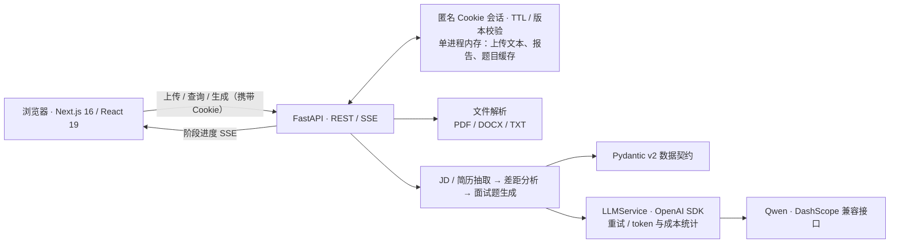
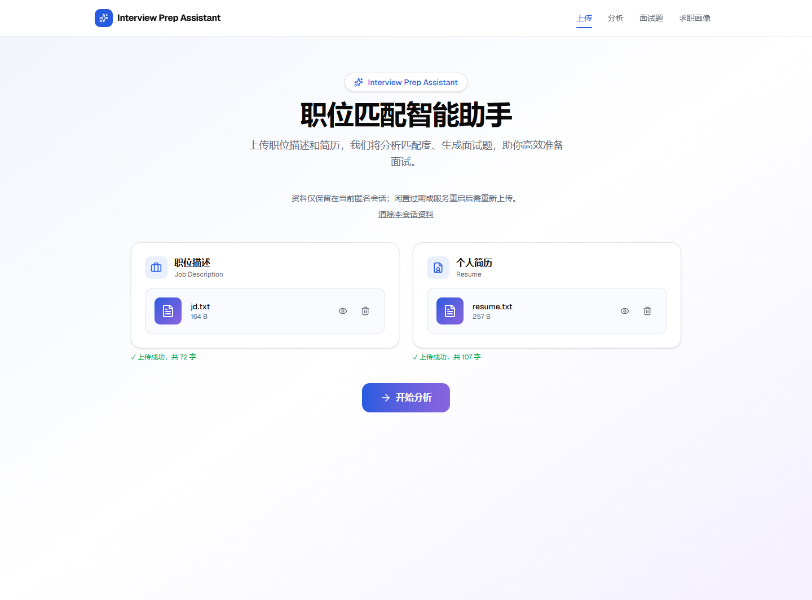
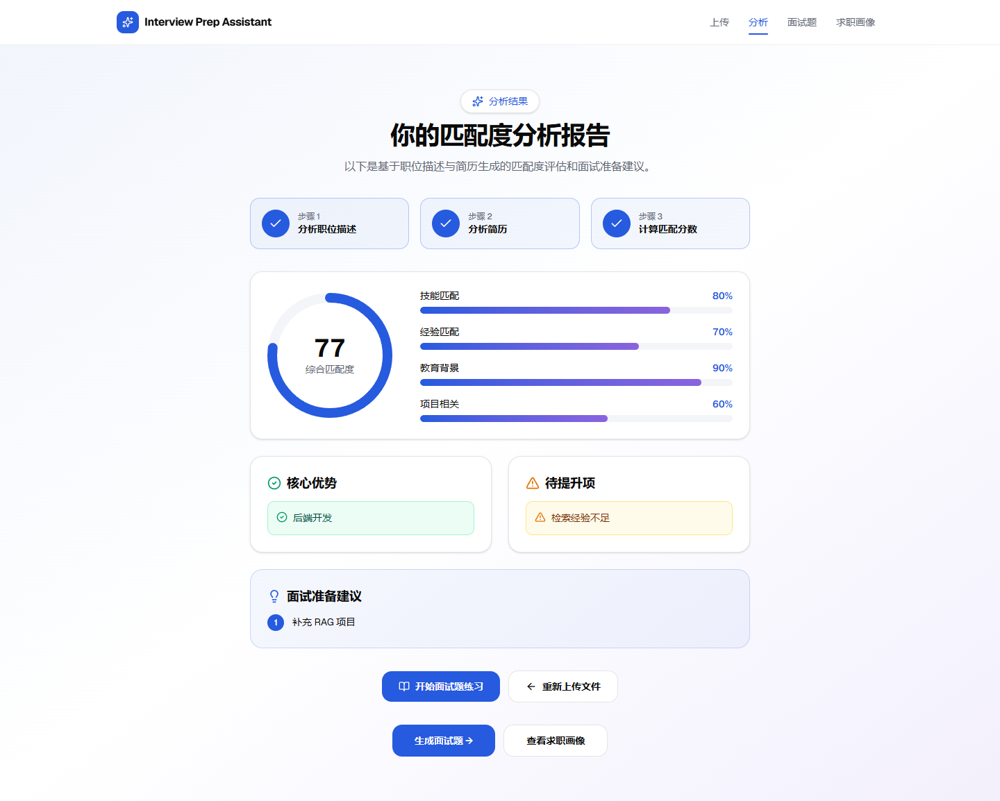
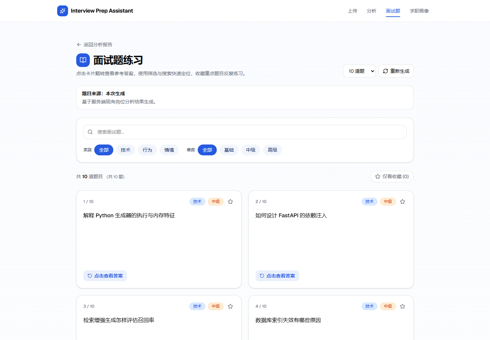

# Interview Prep Assistant

> Next.js + FastAPI 主链路已实现；当前为单进程演示应用。文档更新：2026-10-28。

面向求职者的 AI 面试准备工具。用户上传职位描述（JD）和简历后，系统提取结构化信息、分析岗位匹配度，并生成可筛选的个性化面试题与参考回答。

本项目以一条完整的产品链路展示如何把大模型能力接入可交互的 Web 应用：**文件解析 → 结构化抽取 → 能力差距分析 → 流式反馈 → 面试题生成**。

## 项目亮点

- **端到端真实链路**：Next.js 前端直接调用 FastAPI，上传、分析和题目生成均接入真实后端，而非仅展示静态页面。
- **结构化 LLM 输出**：以 Pydantic 模型约束 JD、简历、差距分析和面试题的数据契约，降低自由文本输出进入业务层的风险。
- **流式用户体验**：分析过程通过 Server-Sent Events（SSE）分阶段返回 JD、简历与差距分析进度，避免长时间请求无反馈。
- **面试题质量控制**：按题量分批生成，对空答案与高相似题去重；当题量不足时会补充生成。
- **工程化边界清晰**：文件类型与大小校验、临时文件清理、错误映射、LLM 重试、日志和 token/cost 统计均位于明确的基础设施边界内。

## 已实现功能

| 能力 | 状态 | 说明 |
| --- | --- | --- |
| JD / 简历上传 | 已实现 | 支持 PDF、DOCX、TXT，单文件最大 10 MB。 |
| 文本解析 | 已实现 | 根据文件类型分派 PDF、DOCX、TXT 解析器。 |
| 岗位与简历结构化抽取 | 已实现 | 提取岗位技能、职责、经历、项目、教育背景等信息。 |
| 匹配度与差距分析 | 已实现 | 输出技能、经验、教育、项目维度的分数、优势、短板与建议。 |
| 流式分析进度 | 已实现 | 通过 SSE 依次推送 JD、简历与差距分析阶段。 |
| 个性化面试题 | 已实现 | 支持生成 10–50 题，包含类型、难度、考察点与参考回答。 |
| 题库交互 | 已实现 | 支持筛选、搜索、翻转卡片、收藏；区分后端缓存、本次生成和固定示例（收藏仅保留在当前题集，切换题集会清空）。 |
| 匿名访客会话 | 已实现 | 上传、报告与题目按随机Cookie隔离；刷新恢复，闲置过期/重启后重新上传；重传和清除后旧任务不能写回。 |
| 求职画像页面 | 尚未开放 | 页面明确说明当前状态，并引导至岗位匹配分析和题库；不调用占位生成接口，不展示虚构评分或薪资。 |

## 技术栈

| 层次 | 技术 |
| --- | --- |
| 前端 | Next.js 16、React 19、TypeScript、Tailwind CSS、Recharts |
| 后端 | FastAPI、Pydantic v2、Uvicorn |
| 大模型 | Qwen（DashScope OpenAI-compatible API），通过 OpenAI Python SDK 调用 |
| 文档解析 | pdfplumber、PyPDF2、python-docx、chardet |
| 测试 | pytest、FastAPI TestClient、前端 ESLint |

## 系统架构



上传先解析文本，再通过三阶段 SSE 完成 JD 抽取、简历抽取与差距分析。题目基于分析结果分批生成、去重并补足；重新上传或清除资料会使旧任务结果失效。数据不写入持久化数据库。

```text
api/                  FastAPI 路由、HTTP 模型、匿名会话
frontend/             Next.js 页面、组件和 REST / SSE 客户端
core/parsers/         PDF、DOCX、TXT 解析
core/analyzers/       JD、简历和岗位差距分析
core/generators/      面试题生成、补足与去重
models/ + prompts/    Pydantic 领域模型与提示词
services/             LLM 调用与用量统计
scripts/ + tests/     离线验证、浏览器验收与合成数据
```

`app/` 和 `run_app.py` 是早期 Streamlit 原型；当前 Web 应用使用下方的 Next.js + FastAPI 启动方式。完整设计见 [Architecture.md](Architecture.md)。

## 运行截图

以下截图于 **2026-10-23** 从本地生产构建页面采集。使用仓库 `tests/fixtures/workflow/` 中的合成 JD、简历及固定模型响应，真实执行上传解析、HTTP 会话、SSE 和题目业务流程；评分与回答仅用于演示，不代表真实 Qwen 生成质量。

### 上传 JD 与简历



### 岗位匹配分析



### 个性化面试题库



## 本地运行

### 1. 准备后端

建议与 CI 保持一致：Python 3.12、Node.js 22、npm。首次获取仓库：

```powershell
git clone https://github.com/Dkgo-0323/Interview-Prep-Assistant.git
Set-Location Interview-Prep-Assistant
```

在项目根目录执行：

```powershell
python -m venv venv
.\venv\Scripts\Activate.ps1
pip install -r requirements.txt
Copy-Item .env.example .env
```

在 `.env` 中填写 DashScope 兼容接口配置，至少包括：

```dotenv
DASHSCOPE_API_KEY=your-api-key
LLM_BASE_URL=https://your-workspace-id.cn-beijing.maas.aliyuncs.com/compatible-mode/v1
LLM_DEFAULT_MODEL=qwen3.7-plus
```

密钥仅放在后端 `.env`，不要提交该文件或写入 `NEXT_PUBLIC_*`。`LLM_BASE_URL` 和模型名应填写自己账号实际可用的配置；上面的工作空间地址需替换。各分析阶段可通过 `.env.example` 中的 `LLM_MODEL_*` 分别配置。

启动 API：

```powershell
uvicorn api.main:app --reload --port 8000
```

服务启动后可访问 [Swagger UI](http://localhost:8000/docs)，健康检查地址为 `http://localhost:8000/api/health`。

### 2. 准备前端

新开一个终端，在项目根目录执行：

```powershell
Set-Location frontend
npm ci
npm run dev
```

打开 `http://localhost:3000`。默认前端会连接 `http://localhost:8000`；如需覆盖，可设置 `NEXT_PUBLIC_API_URL`。

前端与API请统一使用`localhost`，或统一使用`127.0.0.1`，避免跨站Cookie策略影响会话；不同端口仍需CORS允许确切前端origin。后端默认仅允许本机3000端口。匿名会话默认闲置1800秒、最多100个，可通过进程环境变量`SESSION_TTL_SECONDS`、`SESSION_MAX_COUNT`调整；满额时新访客收到503，已有有效会话保留。HTTPS部署需评估`SESSION_COOKIE_SECURE=true`，正式发布另行验收。仅支持单进程/单worker，重启丢失资料。

## 部署步骤（单机演示）

仓库目前没有 Docker / Compose 或一键部署配置。先按上节安装依赖并配置后端 `.env`，再使用生产构建启动两个进程。以下 PowerShell 命令适用于本机演示：

```powershell
# 终端一：仓库根目录，仅一个 worker
.\venv\Scripts\python.exe -m uvicorn api.main:app --host 127.0.0.1 --port 8000 --workers 1
```

```powershell
# 终端二：仓库根目录
Set-Location frontend
$env:NEXT_PUBLIC_API_URL = "http://localhost:8000"
npm ci
npm run build
npm run start -- --hostname 127.0.0.1 --port 3000
```

访问 [应用](http://localhost:3000)、[健康检查](http://localhost:8000/api/health) 和 [接口文档](http://localhost:8000/docs)。健康检查应返回 `{"status":"ok"}`，再用合成资料检查上传、分析与题库。`NEXT_PUBLIC_API_URL` 会在构建时写入前端产物，修改后需要重新构建。

如需域名与 HTTPS，可在这两个回环服务前配置 Nginx。以下 `interview.example.com` 是部署示例域名，应替换为自己的域名，并自行配置证书及 HTTPS server：

```nginx
# 放入已配置 TLS 的 server 块
location /api/ {
    proxy_pass http://127.0.0.1:8000;
    proxy_http_version 1.1;
    proxy_set_header Host $host;
    proxy_set_header X-Forwarded-Proto $scheme;
    proxy_buffering off;
    proxy_cache off;
    proxy_read_timeout 600s;
    client_max_body_size 11m;
}
location / {
    proxy_pass http://127.0.0.1:3000;
    proxy_set_header Host $host;
}
```

域名部署时，在构建前将 `NEXT_PUBLIC_API_URL` 设为 `https://interview.example.com`（不带 `/api` 后缀），将 `api/main.py` 的 `allow_origins` 加入确切的 HTTPS 前端来源，并在**后端启动进程环境**设置 `SESSION_COOKIE_SECURE=true`。会话配置由 `os.getenv` 读取，应在启动前设置；不要只依赖 `.env` 的加载时序。由服务管理器保持两个进程运行，API 保持单 worker。

代理需保留 `/api/` 路径、Cookie 与 SSE，并关闭流式响应缓冲；应用仍限制每个文件 10 MB。上线后需要在实际 HTTPS 域名验证 Cookie、SSE 逐阶段到达、刷新恢复和会话过期。默认网页使用匿名内存，重启丢失访客资料；可选账号记录后端已支持PostgreSQL持久化，“我的记录”页面已接入。当前不支持多worker/多实例，限流与公网部署尚未验收。

## 使用流程

账号模式：导航进入“我的记录”，登录后命名创建记录，在记录内依次上传JD/简历、明确点击分析和生成题目。刷新或分享 `/history?record=<id>` 只读取，仍须本账号登录；新设备登录后可选择同一记录。任务进行/失败/中断时已有内容标为上次成功结果，不自动重新生成。服务默认未配置时页面明确提示，不影响以下匿名流程。登录回调固定返回首页，再进入“我的记录”；匿名资料不自动迁移。账号页浏览器验收使用拦截合成API，不代表真实OAuth/数据库/公网验收。

1. 在首页分别上传 JD 与简历。
2. 进入分析页，查看 SSE 推送的解析进度及最终匹配报告。
3. 进入题库页，生成或读取缓存的个性化面试题。
4. 使用题型、难度、关键词与收藏筛选进行练习。

## API 概览

| 方法 | 路径 | 用途 |
| --- | --- | --- |
| `POST` | `/api/upload/jd` | 上传并解析 JD。 |
| `POST` | `/api/session` | 初始化或恢复匿名HttpOnly Cookie会话；后续REST/SSE须携带该Cookie。 |
| `POST` | `/api/upload/resume` | 上传并解析简历。 |
| `GET` | `/api/analyze/stream` | 以 SSE 执行三阶段分析。 |
| `GET` | `/api/analyze/result` | 读取当前内存会话中的分析结果。 |
| `POST` | `/api/questions/generate` | 根据分析结果生成 10–50 道题。 |
| `GET` | `/api/questions/cached` | 读取当前内存会话中的题目缓存。 |
| `DELETE` | `/api/upload/clear` | 清空当前访客资料，使未完成旧任务结果失效。 |

完整接口契约以运行中的 Swagger 文档为准。

## 验证

日常质量门禁使用固定依赖与经过审阅的离线测试集合（无需模型密钥）：

```powershell
python -m pip install -r requirements-ci.txt
python scripts/check_backend.py

Set-Location frontend
npm ci
npm run check
```

`check` 包含 lint、显式类型检查、离线 API 客户端契约测试和生产构建。后端入口遇到本地回环权限受限时快速报环境错误；请使用允许本机回环的终端。覆盖范围、跳过项及 CI 说明见 [质量门禁](docs/development/quality-gates.md)。

仅复查 API 链路时，也可在已安装依赖的项目 venv 中执行：

```powershell
.\venv\Scripts\python.exe -m pytest tests/test_api_workflow.py tests/test_api_smoke.py -v -p no:cacheprovider

Set-Location frontend
npm run lint
```

测试目录覆盖文件解析、LLM 服务、结构化抽取、差距分析、题目生成及 API 冒烟场景。

上述命令是无需 API Key、不会产生模型费用的 API 链路回归：使用固定虚构 JD / 简历和 Mock LLM 返回值，真实执行上传解析、分析业务逻辑、SSE 序列、题目生成与缓存恢复。它不验证外部模型质量、网络连通性或浏览器逐帧接收 SSE 的时序。请勿将整个 `pytest` 测试目录视为离线测试，其中包含外部 API 测试。

2026-10-18 验证：26 项通过。复现问题、最小修复和完整契约见 [API 链路测试记录](docs/api-workflow-test-record.md)。真实 Qwen 验证可另行按 `tests/test_qwen_integration.py` 中的说明显式启用，会产生 API 用量。

## 面试展示建议

可以围绕以下设计决策展开：

1. 为什么用 Pydantic 约束大模型输出，而不是直接消费自然语言？
2. 为什么把同步 LLM 调用放入线程，并用 SSE 把阶段性结果反馈给浏览器？
3. 为什么题目生成需要分批、补足与相似度去重？
4. 如何将当前内存会话替换为 Redis/数据库，使其支持跨进程会话共享、持久化和横向扩展？

## 当前边界

- 后端以Cookie隔离匿名访客，资料仍在单进程内存；闲置过期或重启即失效，无持久化/多实例共享。隔离不等于账号认证，也不代表公网生产能力已验收。
- S3已有PostgreSQL历史仓库、默认关闭的GitHub后端登录、记录管理及账号记录上传→分析SSE→题库API，包含版本/任务编号与退出后写回保护；配置见[登录手册](docs/development/github-auth.md)和[记录接口](docs/development/history-storage.md)。新增“我的记录”入口 `/history`：GitHub登录/退出、20份命名历史管理及记录内上传→POST流式分析→保存报告/题库已接入；账号后端默认关闭，配置后可用，原首页仍为匿名内存链路。启用账号后端须先显式迁移，并在旧worker停止后单worker启动；遗留任务仅标中断，不自动生成。报告导出和模拟面试未实现。
- 题库页区分当前访客缓存、本次生成与固定示例。缓存仅404会自动进入生成流程；网络或其他HTTP错误显示读取失败及“固定示例，非个性化”，不会自动发起生成，用户可明确点击“重新生成”。410提示会话失效，需回首页重新上传；409提示任务忙或旧结果作废。示例不是个性化结果。
- 求职画像页面当前明确标注尚未开放；后端画像接口仍为历史占位实现，需补充真实分析服务和验收后再开放。

更多设计与运行时边界见 [Architecture.md](Architecture.md)。

## 开发与交接导航

- [当前计划](docs/development/plan.md)：唯一动态计划入口，包含已完成/已确认/候选与待决、验收和依赖。
- [按周记录](docs/development/journal.md)：周一研究、每日交付、真实验证和必要决策。阶段确认后自主连续推进，重要取舍采用 interview；用户每天约10–15分钟理解主线。
- [架构说明](Architecture.md)、[质量门禁](docs/development/quality-gates.md)、[文档索引及历史](docs/development/README.md)：按需参考。旧状态表、每日文件和模板只保留历史，不再重复日常维护。

根 README 仅在用途/运行/演示/入口变化时更新；plan 与 journal 承担日常计划和记录，不要求每天写 prompt 或用户逐文件阅读。
